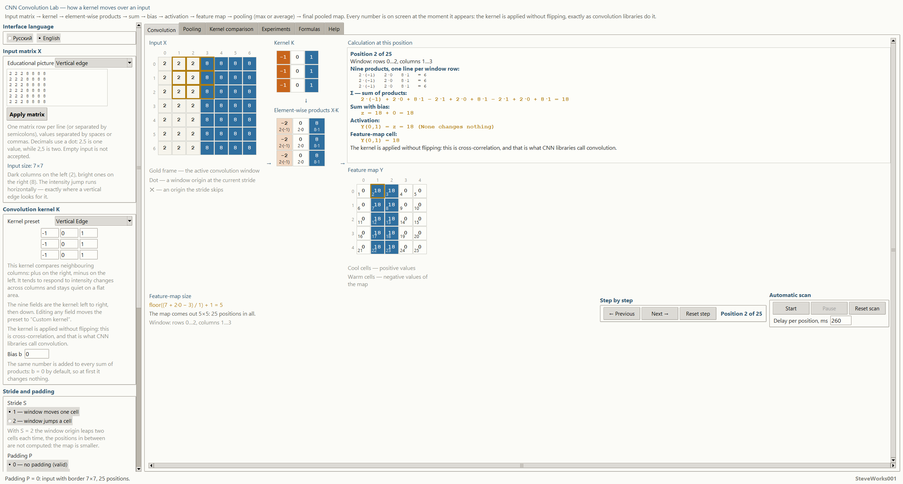
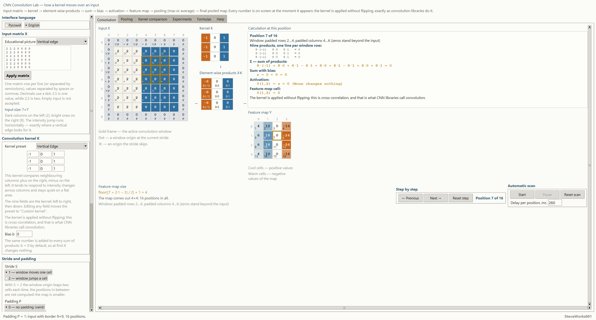
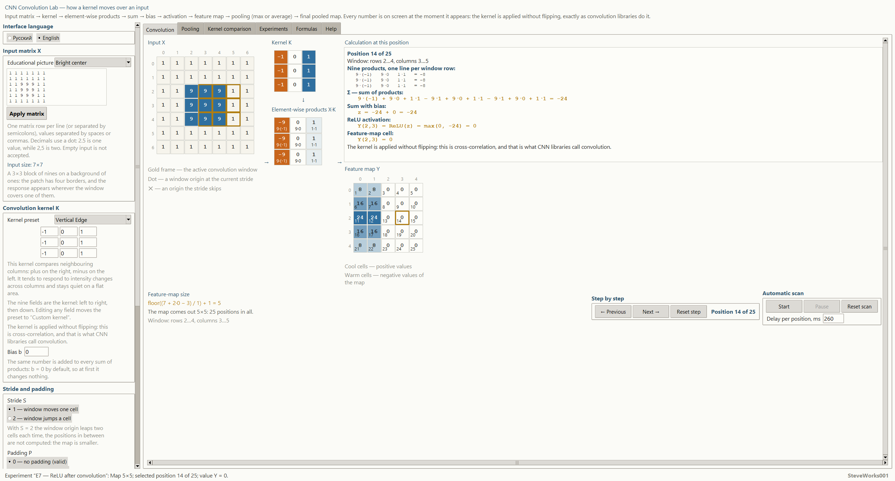
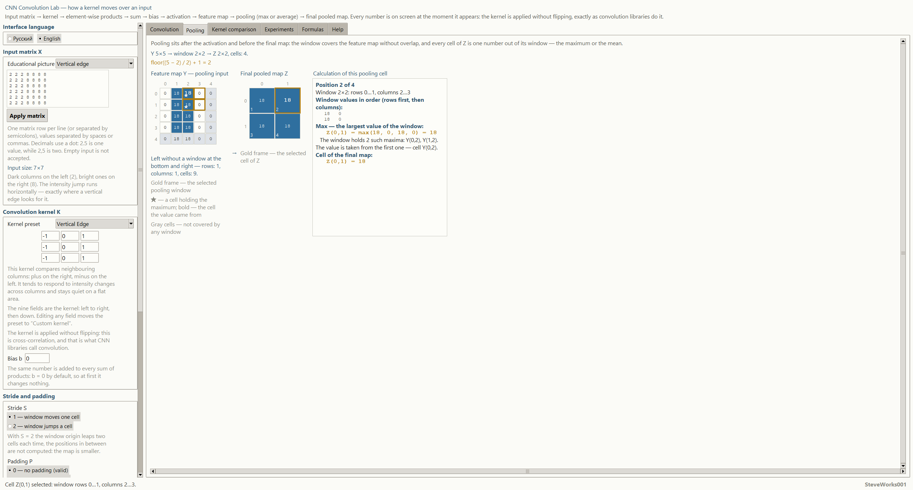
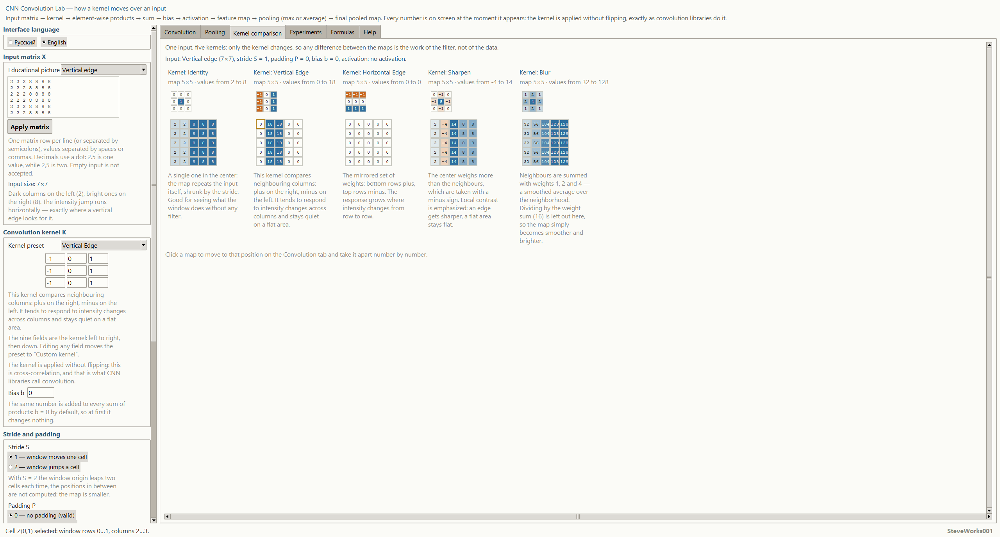

# CNN Convolution Lab — an educational convolution simulator

Project 12 of 13 in the educational neural-network simulator series.
A single-file Python and Tkinter application: standard library only, no external
packages, no network and no dependency installation. It shows one chain down to
the last digit: **input matrix → kernel → element-wise products → sum → bias →
activation → feature map → pooling → final pooled map**. This is not a
machine-learning library and not a network training system.

[Русская версия README](README_RU.md)

---

## Purpose

The simulator answers one question: **what exactly happens at every convolution
position, and why the feature map looks the way it does**. No "magic arrows" and
no labels of the kind "convolution result": the current position shows the window
on the input, the nine products, the sum of those products, the bias added on
top, the activation written out as numbers, and the finished map cell — every
number is real and every intermediate step is on screen.

The main chain the whole interface is built around:

**input → kernel → element-wise products → sum → bias → activation →
feature map → pooling → final pooled map**

Pooling is the last link: it takes the map after activation, shrinks it and does
not recompute anything as a convolution. Nothing follows it.

The same convolution lives on every tab: the map on the comparison tab, the
formula with substituted numbers and the captions under the grids are all
computed from the same values as the large grid on the main tab. Only the angle
changes.

One clarification that is never hidden: the kernel is applied **unflipped**.
Mathematically this is cross-correlation, but this is exactly how convolution
works in neural-network libraries, so the interface calls it a convolution —
both names are shown next to each other.

### What this project does NOT cover

Earlier projects of the series show training. Training is deliberately absent
here:

- no gradients, backpropagation, learning or weight fitting — kernel weights come
  from the user or from a ready teaching preset;
- no normalization, batches, dropout or a stack of layers: pooling is here, but
  exactly one step of it — max or average over a whole window — and the chain ends
  there;
- no stack of convolutional layers: there is exactly one pass;
- no classification, losses, quality metrics or predictions;
- no catalog of activation functions: only the identity function and ReLU, because
  the goal is to watch one number turn into another, not to compare activation
  families;
- no color images and no image files: the input is a numeric matrix, one channel,
  which is what a teaching example should be;
- no pretrained models and no external data of any kind;
- no non-square kernels: the kernel is always a 3×3 square.

All attention goes to one central object: a single position of a single
convolution, taken apart into individual multiplications.

## Learning goals

- Walk the whole chain and see every link of it as numbers.
- Understand that a "filter" is nine numbers, not a black box.
- Understand why the feature map is smaller than the input, and derive its size
  with the formula from the concrete numbers of the current experiment.
- Feel the difference between stride 1 and stride 2 through the skipped
  positions: which window starts disappear and why the map gets smaller.
- Understand what zero padding gives you: the window reaches the very edge of the
  image, a corner input cell takes part in the calculation, and the map stops
  losing its border.
- Understand that the bias is a single number added to every position in exactly
  the same way.
- Understand ReLU as `max(0, z)` on real numbers, including the case where it
  changes nothing.
- Understand why the same input image produces different maps for different
  kernels, and which brightness changes each kernel amplifies.
- Work out how the mathematical "convolution" differs from what neural-network
  libraries do under that word, and why on an asymmetric kernel the difference is
  visible by hand.
- Learn to read the link between a map cell and its input window: clicking a cell
  shows exactly which nine numbers went into it.
- See that pooling works on the map after activation and only shrinks it: it
  invents no new number, it either takes one of the values already computed (max)
  or their mean (average).
- Feel the difference between max and average on the same window, and why an
  average can be longer than what is shown: the screen carries a rounded label
  while the exact quotient is named separately.
- Work out where the cells that do not fit into a window go: an incomplete window
  on the right or at the bottom is dropped whole, and those cells stay grey.

## Mathematics / model: one convolution pass and pooling

| Concept | Notation |
|---|---|
| **Kernel** | `K`, always `3×3`, applied without flipping |
| **Input window** | `X(i+m, j+n)`, where `m, n = 0, 1, 2` |
| **Sum of products** | `Σ Σ X(i+m, j+n) · K(m, n)` |
| **Value before activation** | `z(i, j) = Σ Σ X(i+m, j+n) · K(m, n) + b` |
| **Activation** | `Y = z` or `Y = ReLU(z) = max(0, z)` |
| **Window start** | `i = i₀ · S`, `j = j₀ · S`, where `S` is the stride |
| **Map size** | `floor((N + 2P − K) / S) + 1` along each axis |
| **Padding** | `P = 0` — none, `P = 1` — a one-cell frame of zeros |
| **Final map** | `Z` — the pooling of map `Y`, its windows never overlap |
| **Pooling window** | `W = 2` or `W = 3`, the step equals the window itself |
| **Max Pooling** | `Z(i, j) = max Y(i·W + m, j·W + n)` |
| **Average Pooling** | `Z(i, j) = Σ Σ Y(i·W + m, j·W + n) / W²` |
| **Final map size** | `floor((N − W) / W) + 1` — the same size formula with `P = 0` and `S = W` |

**Element-wise products.** The current position shows all nine pairs: the
multiplicand from the input, the multiplier from the kernel, and their product —
row by row, one row of the window per line. No "total" arrows: a line such as
`2·(-1)   2·0   8·1   = 6` reads as arithmetic, not as a caption for a result.
The three rows of the window give three such lines, each with its own total, and
the panel also writes all nine products out in a single line joined by `+` and
`−` — that line is where the sum comes from.

**Sum and bias.** The sum of the nine products is shown with the same notation as
in the formula, and the bias is added on its own line — you can see that the same
number is added at every position.

**Activation.** With `ReLU` the calculation shows the expanded form
`Y(2,3) = ReLU(z) = max(0, -24) = 0` — that is the "E7 — ReLU after convolution"
scenario — rather than just the final digit: it is visible that a negative value
became zero while a positive one passed through unchanged. With `None` the same
panel writes `Y(0,1) = z = 18 (None changes nothing)`, which is exactly what the
option does.

**Pooling.** The window covers the feature map in whole pieces and shifts by its
own width, so a cell never moves from one window into another. Max compares the
real numbers, not the labels drawn on screen; when several cells hold the same
maximum, all of them are marked and the value is taken from the first one in
row-major order — rows first, then columns. Average adds the window values up in
that same order and divides by how many of them there are: the divisor is `4` in a
`2×2` window and `9` in a `3×3` one, so the exact quotient is often longer than
what is displayed, and the rounding is stated openly. An incomplete window on the
right or at the bottom is not divided by a smaller number of cells: it is dropped
whole, its cells stay grey on the map, and their count is written out as a number.

**Map size.** The size formula is not reference text in the interface — it is the
current configuration with the numbers substituted in: input size, kernel size,
stride, padding and the resulting map size in one line. If the chosen parameters
leave no positions at all, the application says so plainly instead of silently
drawing an empty map.

**Stride.** The window start moves by `S` cells. With `S = 2` the intermediate
starts do not participate: on the input they are marked, so the skip is visible as
skipped cells rather than as a smaller map with no explanation.

**Padding.** The zero frame is drawn on the input as part of the matrix and is
marked, so it is clear which terms in the corner positions come from zeros and
which come from real values.

**Arithmetic.** Everything is computed with plain Python lists, without external
libraries. The teaching values are chosen so that intermediate results are exact:
no rounding "in favor of the picture" and no hidden recomputation. The one place
where a quotient is not always exact is the average over a pooling window: the sum
is exact, while what is shown is rounded to four digits, and the exact value is not
hidden.

**A complete example in numbers.** The default configuration: the "Vertical edge"
input — a `7×7` square whose three left columns are `2` and four right columns
`8`; the "Vertical Edge" kernel — three identical rows `(-1, 0, 1)`;
`S = 1`, `P = 0`, `b = 0`, activation `None`, max pooling with a `2×2` window.
The cell `Y(0,1)` is position 2 of 25 and its input window covers rows 0…2,
columns 1…3. The "Calculation at this position" panel prints exactly these
lines:

```text
2·(-1)   2·0   8·1   = 6
2·(-1)   2·0   8·1   = 6
2·(-1)   2·0   8·1   = 6
2·(-1) + 2·0 + 8·1 − 2·1 + 2·0 + 8·1 − 2·1 + 2·0 + 8·1 = 18
z = 18 + 0 = 18
Y(0,1) = z = 18 (None changes nothing)
Y(0,1) = 18
```

Under the map the size line reads `floor((7 + 2·0 − 3) / 1) + 1 = 5` and "The
map comes out 5×5: 25 positions in all". All five rows of the map are the same:
`0, 18, 18, 0, 0`. The zeros sit where the window fell entirely into the dark or
entirely into the bright half, and the `18`s mark the two positions where the
window covered the brightness jump. Pooling goes on from there: max with a `2×2`
window gives `Z(0,1) = max(18, 0, 18, 0) = 18` and a `2×2` final map
(`floor((5 − 2) / 2) + 1 = 2`); average on the same window gives
`Z(0,1) = (18 + 0 + 18 + 0) / 4 = 9`; nine cells of map `Y` at the bottom and on
the right are left without a window. Nothing in this example is rounded or
fitted: a row totals `6`, the nine products sum to `18`, and `36 / 4` is
exactly `9`.

## Interface and usage

- **On the left** (the column scrolls) — "Interface language"; "Input matrix X"
  with an educational picture preset, a "Custom matrix" block and an "Apply
  matrix" button; "Convolution kernel K" with nine fields and a "Kernel preset"
  choice; "Bias b"; "Stride and padding"; "Activation after convolution";
  "Pooling after activation" with its type ("Max — largest value in the window"
  or "Average — mean of the window") and window size ("2×2, non-overlapping" or
  "3×3, non-overlapping"). At the very bottom of the column is the
  "Reset everything" button: it stops the scan, returns the input, kernel,
  stride, padding, bias, activation, pooling type and pooling window to their
  defaults, puts the selection back on the first position of the map, and writes
  "Reset: the first cell of the map is selected, scan stopped" in the status
  bar.
- **In the center** — the chain laid out in its own order: "Input X" with a gold
  frame around the current window, then "Kernel K" and below it "Element-wise
  products X·K" with a down arrow between them. The columns are separated by `→`
  and `↓` marks: they show the order of the chain, not the link of one cell —
  that link is visible in the gold frame on the input and in the product lines.
  Under the grids — a legend: "Gold frame — the active convolution window",
  "Dot — a window origin at the current stride", "✕ — an origin the stride
  skips", and under the map "Warm cells — negative values of the map" and
  "Cool cells — positive values".
- **On the right** — the "Calculation at this position" panel: the line
  "Position 2 of 25", the coordinates of the window, the heading "Nine products,
  one line per window row:" and the three lines themselves, "Σ — sum of
  products:", "Sum with bias:", "ReLU activation:" — or "Activation:" when the
  option is `None` — and "Feature-map cell:", followed by the note that the
  kernel is applied unflipped. Below the panel sits "Feature map Y", where the
  current cell is outlined in gold.
- **At the bottom of the "Convolution" tab** three blocks share one row. On the
  left — "Feature-map size": the formula `output = floor((input + 2P − K) / S) + 1`,
  the same formula with the numbers of the current configuration
  (`floor((7 + 2·0 − 3) / 1) + 1 = 5`, and for a non-square input two separate
  "Rows:" and "Columns:" lines), the line "The map comes out 5×5: 25 positions in
  all" and the coordinates of the current window. If no position is left, that
  last line becomes "With S = … and P = … the 3×3 window does not fit into a
  …×… input: no positions at all". Next to it — "Step by step" with
  "← Previous", "Next →" and "Reset step" buttons and a position counter. Further
  right — "Automatic scan" with "Start", "Pause" and "Reset scan" buttons and a
  "Delay per position, ms" field that takes a number between `40` and `4000`.
- **Tabs**: "Convolution", "Pooling", "Kernel comparison", "Experiments",
  "Formulas", "Help".
- On the "Pooling" tab — "Feature map Y — pooling input", "Final pooled map Z" and
  the "Calculation of this pooling cell" panel: the coordinates of the window, the
  window values in row-major order, max with every tied cell marked, or average
  with its exact sum, its divisor and the rounding caveat. The selected cell of `Z`
  is outlined in gold, its window is highlighted on `Y`, and the cells left without
  a window are drawn grey and counted in words.
- On the "Kernel comparison" tab — five kernels on the same input: a kernel
  thumbnail, the resulting map, its size, its value range and an honest
  description of what this kernel usually emphasizes. Clicking a cell of such a
  map jumps to the same position on the "Convolution" tab so you can take it apart
  number by number.
- On the "Experiments" tab — the list of seven scenarios, the "Open on the
  Convolution tab" button and the "What comes out" block: the scenario name, its
  teaching goal and one result line such as "Map 5×5; selected position 2 of 25;
  value Y = 18", which the application recomputes from the actual numbers instead
  of keeping a prepared answer.
- On the "Formulas" tab — the main formula, an explanation of every symbol, the map
  size formula with the current numbers substituted, and the activation evaluated
  on the current value.
- On the "Help" tab — sections covering every key concept, plus the keyboard
  shortcuts.
- The usual sequence: pick an input picture → pick a kernel → read "Calculation at
  this position" → walk the map with the "Next" button, watching the gold window
  crawl across the input → set stride 2 and see the skips → turn on padding and see
  the map grow → add a bias and switch on ReLU → set max pooling with a `2×2`
  window and read the final map, then average and a `3×3` window to watch part of
  the map stay without a window → open "Kernel comparison" and
  confirm that the input is the same while the maps differ.
- Mouse: clicking a map cell selects it and highlights the window on the input;
  clicking an input cell moves the window so that it covers that cell; on the
  pooling tab, clicking a cell of `Z` shows its window on map `Y`, and clicking a
  cell of `Y` moves the window so that it covers that cell — if the cell was left
  without a window, the application says so plainly instead of moving nothing; the
  mouse wheel scrolls whichever region the pointer is over.
- Keyboard: `←` and `→` step through positions, `Home` jumps to the first one,
  `Space` starts or stops the scan, `Enter` in a field applies that field,
  `Ctrl+Enter` in the matrix field applies the matrix. The first three work only
  while the focus is not inside an input field — in a field the arrows, `Home`
  and the space bar belong to the text being typed. `Enter` applies the kernel,
  bias and delay fields, while `Enter` without `Ctrl` in the matrix field just
  breaks the line.
- Which separator works depends on the field. In "Custom matrix" the values of a
  row are separated by a space, a tab or a comma, and rows by a line break or a
  semicolon; the fractional part uses a dot, so `2.5` is one value while `2,5` is
  two. In the nine kernel fields, in the bias field and in the delay field a
  comma is accepted as the decimal separator: `0,25` means `0.25`. Bad input
  never crashes the application: the field is highlighted, a readable message
  appears in the status bar ("Fix the field: the previous value is still in the
  calculation"), and the previous valid value is kept. An empty matrix, rows of
  different lengths, a non-number, a value whose absolute value is above `99`, a
  size outside `3×3 … 9×9` and a configuration with no positions at all are each
  explained separately.

The interface is fully available in Russian and English and switches without a
restart; the current state — input, kernel, stride, padding, bias, activation,
pooling type and window, selected position, selected cell of the final map, active
tab and help section — is preserved when the language changes.

## Ready-made experiments

Seven scenarios, each of which sets up a configuration and explains what you are
meant to see in it:

1. "E1 — vertical edges": matching input and kernel; the window that catches the
   brightness jump gives `18`, windows sitting wholly in the dark or wholly in
   the bright half give `0`;
2. "E2 — horizontal edges": the same trick across; the `5×5` map lights up as two
   middle rows of `18`, while the empty middle row of the kernel multiplies
   nothing;
3. "E3 — smoothing": the blur kernel on the cross; the map is smoother and larger
   than the input — from `16` in the corners to `100` in the middle — because the
   weights `1, 2, 4` add nine neighbors and never divide by `16`;
4. "E4 — local contrast": the sharpen kernel on the bright patch; inside the
   patch the map equals the input (`9`), on its edge it grows to `17`, and just
   beyond the edge it falls to `-7`;
5. "E5 — stride 2": the same input and kernel, but the map is `3×3` instead of
   `5×5`, and the skipped window starts are marked `✕` on the input;
6. "E6 — zero padding": the same set with `P = 1`; the map grows from `5×5` to
   `7×7`, and the corner position gives `4` because part of the weights multiply
   the zeros of the frame;
7. "E7 — ReLU after convolution": the vertical-edge kernel on the bright patch;
   left of the boundary the sum is `24`, right of it `-24`, ReLU zeroes the
   negative half, and the selected cell shows `z = -24` before activation.

The scenario itself contains no prepared answer: the application recomputes the map
from the actual numbers, so if you change the stride or the bias inside the same
scenario you get an honest recomputation rather than a repeat of the old caption.
The final map is recomputed right after the feature map; a scenario never touches
the pooling type or its window — those stay yours.

## Help

Nine short sections: how element-wise multiplication works, the whole chain end to
end, what a position and a stride are, how stride 2 differs from stride 1, why a
bias is needed, how pooling after activation works and where the cells left without
a window go, how the teaching kernels differ, what stays outside this
application, and which keys work. Formulas appear only where they are unavoidable;
a full textbook is not embedded into the application.

## Guided experiments

Five experiments on the application's own interface. The numbers under "Observe"
come from running one specific configuration, not from general theory: change
the stride or the bias inside the same experiment and the application
recomputes honestly.

**1. Two windows on the same edge.**
Change: leave the default configuration and click the cell `Y(0,0)` on the
feature map, then click `Y(0,1)`.
Observe: the first window covers columns 0…2 — all twos — and the calculation
panel gives a sum of `0`; the second stands on columns 1…3, catches two `2`s and
one `8`, its row totals `6`, and the nine products add up to `18`.
Think about: why is `Y(0,2)` also `18`, although that window covers a different
combination of numbers — `2, 8, 8`?

**2. Stride 2 instead of stride 1.**
Change: in "Stride and padding" choose "2 — window jumps a cell" and touch
nothing else.
Observe: the size line becomes `floor((7 + 2·0 − 3) / 2) + 1 = 3`, the caption
says "The map comes out 3×3: 9 positions in all", the position counter reads "of
9", and `✕` marks appear on the input where a window could have stood and did
not.
Think about: the map lost more than half of its cells — `9` instead of `25`.
Why is the shrink here quadratic, and what does that have to do with the stride
acting along both axes?

**3. A zero frame moves the border.**
Change: switch on "1 — zero border (same)" and click the corner cell `Y(0,0)`.
Observe: the map grows from `5×5` to `7×7` — 49 positions — the corner cell is
`4`, and the window caption says "Window: padded rows 0…2, padded columns 0…2
(zeros stand beyond the input)". The right edge of the map is
negative at the same time: `-16` and `-24`.
Think about: with `P = 0` that corner position did not exist at all. What
created it, and why is its number below `18` when the brightness jump is the
same?

**4. Max and average on one and the same window.**
Change: on the "Pooling" tab set "3×3, non-overlapping" while map `Y` is the one
from the default configuration, and compare the two modes.
Observe: max gives `Z(0,0) = max(0, 18, 18, 0, 18, 18, 0, 18, 18) = 18`, average
gives `Z(0,0) = (0 + 18 + 18 + 0 + 18 + 18 + 0 + 18 + 18) / 9 = 12`; in both
cases the final map is a single cell, and in both cases 16 cells of map `Y` at
the bottom and on the right stay without a window.
Think about: the mean is below the maximum exactly because six of the nine cells
in that window are zeros. What would average show on a map where the brightness
jump fell into every cell?

**5. A bias that silences the whole map.**
Change: put `-18` into the "Bias b" field and switch on "ReLU — max(0, z)".
Observe: with activation `None` every row of the map is `-18, 0, 0, -18, -18` —
the same number added to the same products; with ReLU all five rows turn into
zeros, because `max(0, 0) = 0` and `max(0, -18) = 0`.
Think about: a bias is not a filter, it shifts the whole map at once. At which
`b` does the edge stop responding altogether, and why does that number depend on
the brightness of the input?

---

## Installation and launch

Nothing has to be installed or built — running the single file from the project
folder is enough.

**Windows:**

```bash
python cnn_convolution_lab.py
```

**macOS and Linux:**

```bash
python3 cnn_convolution_lab.py
```

Quick start: the window opens on the default configuration — the "Vertical edge"
input, the "Vertical Edge" kernel, `S = 1`, `P = 0`, `b = 0`, activation `None`,
max pooling with a `2×2` window, the first position selected — and the status
bar reads `Ready: input “Vertical edge”, kernel “Vertical Edge”, map 5×5`.
Clicking a map cell moves the window, "Next →" walks the positions, "Start" runs
the scan, and "Reset everything" brings the original view back.

## Screenshots

The shots were taken from the running file shipped in this folder, in a maximized
window of 2560×1377 pixels on a 2560×1440 screen. The Russian and the English
series show the same five states, so the frames can be compared line by line; the
numbers in the captions are exactly what the application printed at the moment of
the capture.

**Convolution at the default configuration, one position taken apart.** Input
"Vertical edge", kernel "Vertical Edge", `S = 1`, `P = 0`, `b = 0`, activation
`None`, cell `Y(0,1)` selected. The calculation panel reads "Position 2 of 25",
three identical rows `2·(-1)   2·0   8·1   = 6`, the sum of nine products
`= 18` and `z = 18 + 0 = 18`; the feature map is `5×5` with even rows
`0 18 18 0 0`, and its size comes from `floor((7 + 2·0 − 3) / 1) + 1 = 5`.



**Stride 2 with a zero border: a smaller map and a negative edge.** Same input
and kernel, `S = 2`, `P = 1`. The size line becomes
`floor((7 + 2·1 − 3) / 2) + 1 = 4`, below it "The map comes out 4×4: 16 positions
in all", and the step counter reads "Position 7 of 16". The input shows `✕` marks
where the window origin was skipped and `P` in the zero border, the selected cell
is zero, and the right edge of the map is negative: `-24`.



**ReLU silences a negative sum.** The ready-made experiment
"E7 — ReLU after convolution" is applied: input "Bright center", the same kernel,
selected position 14 of 25. The nine products give `-24`, `z = -24 + 0 = -24`, and
the panel reads `Y(2,3) = ReLU(z) = max(0, -24) = 0`; that cell is highlighted on
the map and equals zero while its neighbours to the left carry `24`.



**Max pooling with a 2×2 window on the same map.** The Pooling tab, mode max,
window `2×2`: `Y 5×5 → window 2×2 → Z 2×2, cells: 4`, the formula
`floor((5 − 2) / 2) + 1 = 2`, selected cell 2 of 4. The panel computes
`Z(0,1) = max(18, 0, 18, 0) = 18` and adds that the window holds two equal maxima
and the value comes from the first one — cell `Y(0,2)`. Below and to the right the
caption states how many map cells fall outside any window: 9.



**One input, five kernels.** The Kernel comparison tab shows five maps built from
the same picture: Identity (values from 2 to 8), Vertical Edge (0 to 18),
Horizontal Edge (0 to 0 — on a vertical edge such a kernel stays silent), Sharpen
(-4 to 14) and Blur (32 to 128). The spread of the ranges follows from the
weights, not from different data.



## Requirements

- Python 3.8 or newer.
- Tkinter — included in the official Python builds for Windows and macOS; some
  Linux distributions ship it separately as the `python3-tk` package.
- Standard library only: `math`, `tkinter`, `tkinter.ttk`, `tkinter.font`,
  `dataclasses`.
- Not used: NumPy, pandas, SciPy, scikit-learn, PyTorch, TensorFlow, OpenCV,
  matplotlib and any third-party GUI framework.
- No network connection is needed for the application to run.

The application opens a large window and is designed for a typical desktop
display. Its initial size is `min(max(1520, 86 % of screen width), width − 20)`
by `min(max(820, 88 % of screen height), height − 20)` pixels; where Tk allows
it, the window opens zoomed. The minimum size is `1400×720 px`, or
`min(1400, width − 40)` by `min(720, height − 60)` pixels on a smaller screen.
The parameter column and the tabs scroll rather than get clipped: on a narrow
screen the chain of five columns leaves the visible area only together with a
scrollbar.

## Limitations

- One pass, one kernel, one input channel: no stack of layers, no multiple channels,
  no connections between feature maps.
- The kernel is always a 3×3 square; kernels of other sizes and shapes are not
  considered by the application.
- Stride is only `1` or `2`, padding is only `0` or `1` and only with zeros: no
  reflected, circular or arbitrary padding.
- Two activations: identity and ReLU. No Leaky ReLU, no sigmoid, no softmax.
- Exactly one pooling step, and only non-overlapping: the window is `2×2` or `3×3`
  and its stride equals its own size. There is no sliding, overlapping, adaptive or
  learned pooling, and no second pooling after the first.
- An incomplete window on the right or at the bottom is dropped whole: those cells
  stay grey on the map and are counted in words, but they do not reach the final
  map — the size rounds down, not up.
- The average is shown rounded to four digits: the window sum is exact, the
  quotient is not — most often in a `3×3` window, where the divisor `9` is not a
  power of ten.
- When several cells hold the same maximum, Max marks every tied cell and takes the
  value from the first one in row-major order (rows, then columns). This is a
  teaching convention about display only: the number itself does not depend on the
  chosen cell.
- The input is a matrix from `3×3` to `9×9`, and the absolute value of any number is
  at most `99`. This is a teaching size: a real image does not fit here, and nobody
  tries to make it.
- One bias for the whole map: there are no per-channel biases, because there is one
  channel.
- The automatic scan is a visual aid, not a performance measurement: the delay
  between positions is set in milliseconds, and the actual pace is also limited by
  the redraw cost.
- The cell color is a way to show magnitude, not part of the calculation: it does
  not influence any number.
- The operation is called a convolution, as in neural-network libraries, but it is
  performed without flipping the kernel. For symmetric kernels the two are the same;
  for asymmetric ones the result comes out mirrored, and the application shows this
  openly instead of hiding it behind a term.

## Educational note

The simulator exists so that you see and remember one link: "input window — nine
products — sum — bias — activation — map cell — pooling window — final map cell".
Some conventions are chosen for
clarity and may differ from those of a particular library: the input and kernel
sizes, zero padding instead of automatic "same" padding, one of two activations, a
stride of at most two, a single non-overlapping pooling step with a `2×2` or `3×3`
window, and an incomplete window dropped instead of averaged over a truncated
edge. When you carry these conventions into a real model, remember
that here there is one pass and one channel, while a real convolutional network is
many channels, many layers and learned weights that do not follow from this picture
for a simple reason.

## What to know beforehand

**Strictly necessary:** Python 3 with Tkinter, and running one file from a
command line. No `pip` packages, no network, no external data, no settings
files.

**Mathematics:** the multiplication table, adding negative numbers, and reading
a line such as `2·(-1) + 2·0 + 8·1 = 6` as arithmetic rather than as a caption.
No derivatives, integrals or matrix algebra: a convolution here is nine products
and one addition. `floor` appears exactly once, in the map size formula, and it
means "round down to an integer" — for an `8×8` input with `S = 2` it comes out
`floor((8 − 3) / 2) + 1 = 3`, not `3.5`.
Pooling adds a division by `4` or by `9`, and nothing else.

**Useful but not required:** project 1, "One Artificial Neuron" — there the same
operation runs on a single neuron: a sum of products and an activation. Here
there are twenty-five such sums over one picture, all sharing the same nine
weights. Project 7, "Activation Functions" — there ReLU is compared with other
functions, while here it stands alone so that the step from `z` to a map cell is
visible. No project of the series has to be done first in order to open this
application.

**About the Python version:** the "Requirements" section names Python 3.8 or
newer. The application does not check the version, and running it on other
versions has not been tested — this is declared compatibility, not a verified
guarantee. Every check in this release was made in one environment: Python
3.12.10 with Tk 8.6 on Windows x64 (build 10.0.19045). No other Python version
and no other operating system is covered by a run.

---

## Place in the series

Project 12 of 13. The order is not strict: every project runs on its own and
reads nothing from its neighbours. Below are only the links that exist by
content.

| Project | Link by content |
|---|---|
| 1 — One Artificial Neuron | there one sum of products and one activation; here the same operation repeated by the same nine weights in every window of the picture |
| 3 — Mini Neural Network | there every neuron of a layer looks at all the previous ones; here a "neuron" looks only at a `3×3` window |
| 5 — Backpropagation | there the gradient is obtained by running the network backwards; here there is no training at all: the kernel weights come from the user or a preset |
| 7 — Activation Functions | there a catalog of activations across the whole axis; here exactly two options, `None` and ReLU, both placed after the convolution |
| 9 — Classification | there predictions are scored with metrics; here nothing is predicted and the result is a feature map |
| 11 — Optimizers | there five weight-update rules argue; here nobody updates any weights, and the argument is only about the size of the map |
| 13 — Multiclass Softmax | there one output layer divides its response between classes; here there is one input channel of brightness and no classes at all |

---

## Developer

**Developer: SteveWorks001**

## License

This project is distributed under the MIT license; the full text lives in the
[LICENSE](LICENSE) file.
