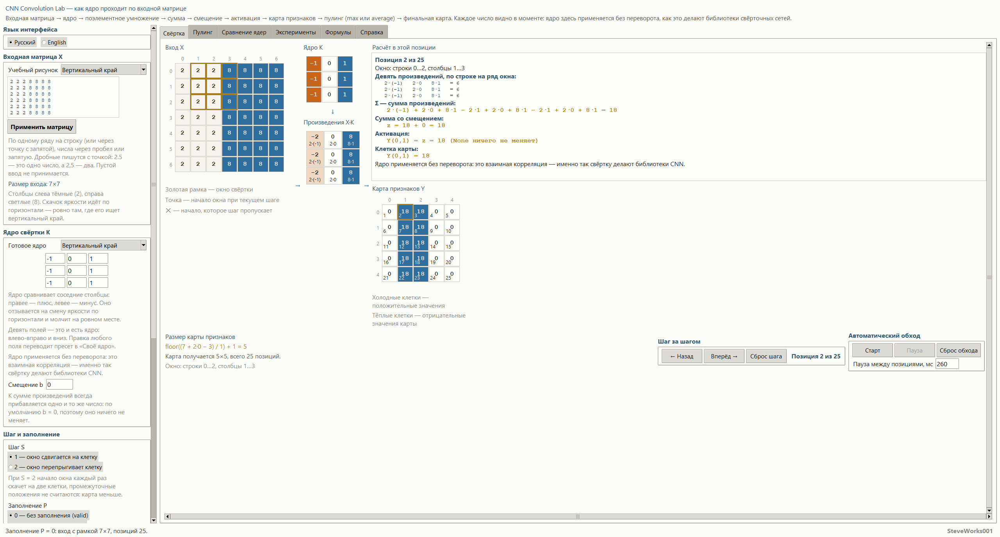
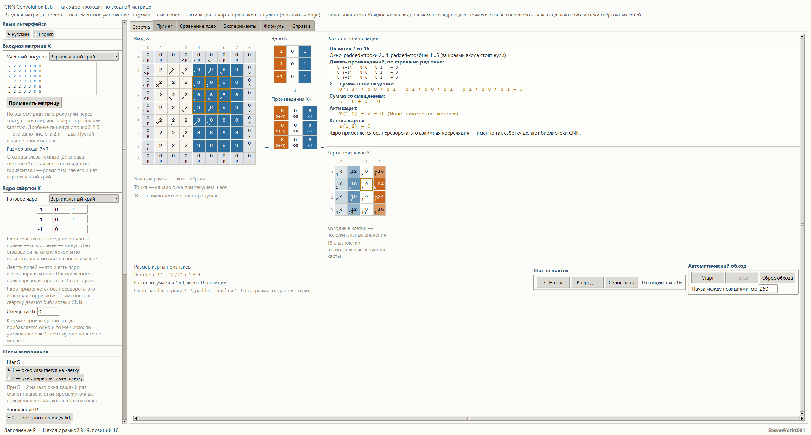
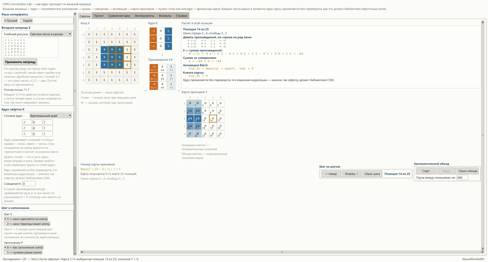
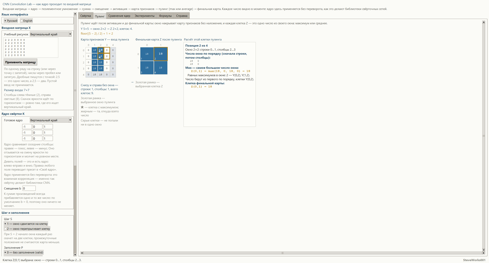
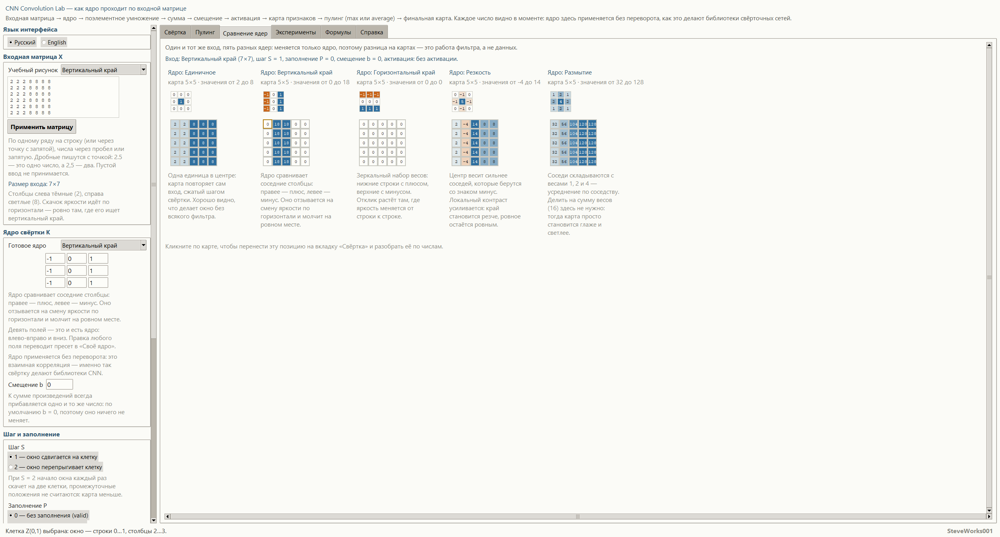

# CNN Convolution Lab — учебный симулятор свёртки

Проект 12 из 13 учебных симуляторов нейронных сетей.
Однофайловое приложение на Python и Tkinter: только стандартная библиотека,
без внешних пакетов, без сети и без установки зависимостей.
Показывает одну цепочку до последней цифры: **входная матрица → ядро →
поэлементное умножение → сумма → смещение → активация → карта признаков →
пулинг → финальная карта**.
Это не библиотека машинного обучения и не система обучения нейронных сетей.

[English version](README_EN.md)

---

## Назначение

Симулятор отвечает на один вопрос: **что именно происходит в каждой позиции
свёртки и почему карта признаков выглядит так, а не иначе**. Никаких «магических
стрелок» и никаких подписей вида «результат свёртки»: в текущей позиции видно
окно на входе, девять произведений, сумму этих произведений, прибавленное
смещение, активацию в числах и готовую клетку карты — все числа настоящие, все
промежуточные шаги показаны.

Основная цепочка, на которой построен весь интерфейс:

**вход → ядро → поэлементное умножение → сумма → смещение → активация →
карта признаков → пулинг → финальная карта**

Пулинг — последнее звено: он берёт карту признаков уже после активации,
уменьшает её и ничего не пересчитывает свёрткой. За ним новых стадий нет.

Одна и та же свёртка живёт на всех вкладках: карта на вкладке сравнения,
формула с подставленными числами и подписи под сетками считаются из тех же
значений, что и большая сетка на главной вкладке. Меняется только ракурс.

Важное уточнение, которое нигде не скрыто: ядро применяется **без переворота**.
Математически это взаимная корреляция, но именно так работает свёртка в
библиотеках нейросетей, поэтому в интерфейсе она называется свёрткой — и то и
другое имя показано рядом.

### Чего в этом проекте нет

Предыдущие проекты серии показывают обучение. Здесь обучения нет намеренно:

- нет градиентов, обратного распространения, обучения и подбора весов — веса
  ядра задаёт пользователь или готовый учебный пресет;
- нет нормализации, батчей, дропаута и многослойной архитектуры: пулинг есть,
  но ровно один — max или average по целому окну, и на этом цепочка
  заканчивается;
- нет свёрточных слоёв в количестве нескольких штук: проход ровно один;
- нет классификации, потерь, метрик качества и предсказаний;
- нет каталога функций активации: есть только тождественная и ReLU, потому что
  задача — увидеть, как одно число превращается в другое, а не сравнивать
  семейства активаций;
- нет цветных изображений и файлов картинок: вход — числовая матрица, один
  канал, как это и делает учебный пример;
- нет предобученных моделей и никаких внешних данных;
- нет многомерных ядер: ядро всегда квадрат 3×3.

Всё внимание — одному центральному объекту: одной позиции одной свёртки,
разобранной до отдельных умножений.

## Учебные цели

- Пройти цепочку целиком и увидеть каждое её звено в числах.
- Понять, что «фильтр» — это девять чисел, а не чёрный ящик.
- Понять, почему карта признаков меньше входа, и вывести её размер формулой по
  конкретным числам текущего опыта.
- Понять разницу между шагом 1 и шагом 2 на пропусках: какие начала окна
  пропадают и почему карта становится меньше.
- Понять, что даёт заполнение нулями: окно встаёт у самого края картинки,
  угловая клетка входа попадает в расчёт, и карта перестаёт терять границу.
- Понять, что смещение — это одно число, прибавляемое ко всем позициям одинаково.
- Понять ReLU как `max(0, z)` на настоящих числах, включая случай, когда она
  ничего не меняет.
- Понять, почему одно и то же входное изображение даёт разные карты у разных
  ядер, и какие перепады яркости каждое ядро усиливает.
- Разобраться, чем математическая «свёртка» отличается от того, что под этим
  словом делают библиотеки нейросетей, и почему на несимметричном ядре это
  различие видно руками.
- Научиться читать связь между клеткой карты и окном на входе: клик по клетке
  показывает, какие именно девять чисел в неё вошли.
- Увидеть, что пулинг работает с картой после активации и только уменьшает её:
  ни одного нового числа он не изобретает, а берёт одно из уже посчитанных
  (max) или их среднее (average).
- Понять разницу между max и average на одном и том же окне и почему среднее
  бывает длиннее, чем показано: на экране округлённая подпись, а точное частное
  названо отдельно.
- Разобраться, куда деваются клетки, для которых не хватает места в окне:
  неполное окно справа и снизу отбрасывается целиком, и эти клетки видно серыми.

## Математика: один проход свёртки и пулинг

| Понятие | Запись |
|---|---|
| **Ядро** | `K`, всегда `3×3`, применяется без переворота |
| **Окно на входе** | `X(i+m, j+n)`, где `m, n = 0, 1, 2` |
| **Сумма произведений** | `Σ Σ X(i+m, j+n) · K(m, n)` |
| **Значение до активации** | `z(i, j) = Σ Σ X(i+m, j+n) · K(m, n) + b` |
| **Активация** | `Y = z` или `Y = ReLU(z) = max(0, z)` |
| **Начало окна** | `i = i₀ · S`, `j = j₀ · S`, где `S` — шаг |
| **Размер карты** | `floor((N + 2P − K) / S) + 1` по каждой оси |
| **Заполнение** | `P = 0` — без него, `P = 1` — рамка из нулей шириной в клетку |
| **Финальная карта** | `Z` — пулинг карты `Y`, окна не перекрываются |
| **Окно пулинга** | `W = 2` или `W = 3`, шаг равен самому окну |
| **Max Pooling** | `Z(i, j) = max Y(i·W + m, j·W + n)` |
| **Average Pooling** | `Z(i, j) = Σ Σ Y(i·W + m, j·W + n) / W²` |
| **Размер финальной карты** | `floor((N − W) / W) + 1` — та же формула размера при `P = 0` и `S = W` |

**Произведение по элементам.** В текущей позиции показаны все девять пар:
множимое из входа, множитель из ядра и их произведение — строками, по строке
окна. Никаких «суммарных» стрелок: строка вида
`2·(-1)   2·0   8·1   = 6` читается как арифметика, а не как подпись результата.
Три ряда окна дают три такие строки, и в каждой — свой итог; те же девять
слагаемых панель печатает и одной общей строкой, через `+` и `−`, — её итог и
есть сумма произведений, к которой потом прибавляется смещение.

**Сумма и смещение.** Сумма девяти произведений показана той же записью, что и
в формуле, а смещение прибавляется отдельной строкой — видно, что к каждой
позиции добавляется одно и то же число.

**Активация.** При `ReLU` в расчёте стоит раскрытая запись
`Y(2,3) = ReLU(z) = max(0, -24) = 0` — это сценарий «Э7 — ReLU после свёртки»,
а не просто итоговая цифра: видно, что отрицательное значение обнулилось, а
положительное прошло без изменений. При `None` той же конфигурации панель пишет
`Y(0,1) = z = 18 (None ничего не меняет)`: опция названа своим реальным
действием.

**Пулинг.** Окно накладывается на карту признаков целыми кусками и сдвигается
на свою ширину, поэтому клетка не переходит из окна в окно. Max сравнивает
настоящие числа, а не подписи на экране; если равных максимумов несколько,
помечены все, а число берут из первой по порядку клетки — сначала строки, потом
столбцы. Average складывает числа окна в том же порядке и делит на их
количество: в окне `2×2` делитель `4`, в окне `3×3` — `9`, поэтому точное
частное бывает длиннее показанного, и округление названо прямо. Неполное окно
справа или снизу не делят на меньшее число клеток: оно отбрасывается целиком, а
его клетки остаются на карте серыми, и их количество подписано числом.

**Размер карты.** Формула размера живёт в интерфейсе не как справка, а как
подставленные числа текущей конфигурации: размер входа, размер ядра, шаг,
заполнение и полученный размер карты — в одной строке. Если при выбранных
параметрах позиций не остаётся, приложение говорит об этом прямо и не рисует
пустую карту молча.

**Шаг.** Начало окна сдвигается на `S` клеток. При `S = 2` промежуточные начала
не участвуют: на входе они помечены, и пропуск виден как пропущенные клетки, а
не как уменьшившаяся карта без объяснений.

**Заполнение.** Нулевая рамка рисуется на входе как часть матрицы и помечена,
поэтому видно, какие слагаемые в угловых позициях приходят из нулей, а какие —
из настоящих значений.

**Арифметика.** Всё считается на списках Python, без внешних библиотек.
Учебные значения подобраны так, чтобы промежуточные результаты были точными:
никакого округления «в пользу картинки» и никаких скрытых пересчётов.
Единственное место, где частное не всегда точно, — среднее по окну пулинга:
сумма считается точно, а показывается результат с округлением до четырёх
знаков, и точное значение не прячут.

**Полный пример на числах.** Конфигурация по умолчанию: вход «Вертикальный
край» — квадрат `7×7`, где три левых столбца равны `2`, а четыре правых `8`;
ядро «Вертикальный край» — три одинаковых ряда `(-1, 0, 1)`; `S = 1`, `P = 0`,
`b = 0`, активация `None`, пулинг max окном `2×2`. Клетка `Y(0,1)` — позиция 2
из 25, её окно на входе — строки 0…2, столбцы 1…3. Панель «Расчёт в этой
позиции» печатает для неё ровно такие строки:

```text
2·(-1)   2·0   8·1   = 6
2·(-1)   2·0   8·1   = 6
2·(-1)   2·0   8·1   = 6
2·(-1) + 2·0 + 8·1 − 2·1 + 2·0 + 8·1 − 2·1 + 2·0 + 8·1 = 18
z = 18 + 0 = 18
Y(0,1) = z = 18 (None ничего не меняет)
Y(0,1) = 18
```

Под картой строка размера: `floor((7 + 2·0 − 3) / 1) + 1 = 5` и «Карта
получается 5×5, всего 25 позиций». Все пять строк карты одинаковы:
`0, 18, 18, 0, 0`. Нули стоят там, где окно встало целиком в тёмную или целиком
в светлую половину, `18` — на двух позициях, где окно накрыло границу яркости.
Дальше пулинг: max окном `2×2` даёт `Z(0,1) = max(18, 0, 18, 0) = 18` и финальную
карту `2×2` (`floor((5 − 2) / 2) + 1 = 2`); average на том же окне даёт
`Z(0,1) = (18 + 0 + 18 + 0) / 4 = 9`; девять клеток карты `Y` снизу и справа
остаются без окна. Ни одно число в этом примере не округлено и не подогнано:
итог ряда — `6`, сумма девяти произведений — `18`, частное `36 / 4` — ровно `9`.

## Интерфейс и как пользоваться

- **Слева** (колонка прокручивается) — «Язык интерфейса»; «Входная матрица X» с
  выбором учебного рисунка, блоком «Своя матрица» и кнопкой «Применить матрицу»;
  «Ядро свёртки K» с девятью полями и выбором «Готовое ядро»; «Смещение b»;
  «Шаг и заполнение»; «Активация после свёртки»; «Пулинг после активации» с
  типом («Max — максимум в окне» или «Average — среднее в окне») и размером окна
  («2×2, без наложения» или «3×3, без наложения»). В самом низу колонки — кнопка
  «Сбросить всё»: она останавливает обход, возвращает вход, ядро, шаг,
  заполнение, смещение, активацию, режим и окно пулинга к значениям по
  умолчанию, выбранную клетку — к первой позиции карты, и пишет в статус
  «Сброс: выбрано начало карты, обход остановлен».
- **В центре** — цепочка, разложенная по порядку своих блоков: «Вход X» с
  золотой рамкой текущего окна, затем «Ядро K» и под ним «Произведения X·K»,
  между ними стрелка вниз. Колонки разделены знаками `→` и `↓`: они показывают
  порядок цепочки, а не связь отдельной клетки — связь видно по золотой рамке на
  входе и по строкам произведений. Под сетками — обозначения: «Золотая рамка —
  окно свёртки», «Точка — начало окна при текущем шаге», «✕ — начало, которое
  шаг пропускает», а под картой — «Тёплые клетки — отрицательные значения
  карты» и «Холодные клетки — положительные значения».
- **Справа** — панель «Расчёт в этой позиции»: строка «Позиция 2 из 25»,
  координаты окна, заголовок «Девять произведений, по строке на ряд окна» и сами
  три строки, «Σ — сумма произведений:», «Сумма со смещением:», «Активация ReLU:»
  — или «Активация:», если стоит `None`, — и «Клетка карты:», а в конце
  пояснение, что ядро применяется без переворота. Под панелью — «Карта признаков
  Y», где текущая клетка обведена золотым.
- **Внизу вкладки «Свёртка»** в один ряд стоят три блока. Слева — «Размер
  карты признаков»: формула `выход = floor((вход + 2P − K) / S) + 1`, та же
  формула с числами текущей конфигурации (`floor((7 + 2·0 − 3) / 1) + 1 = 5`, а
  для неквадратного входа — отдельной строкой «Строки: …» и «Столбцы: …»),
  строка «Карта получается 5×5, всего 25 позиций» и координаты текущего окна;
  если позиций не остаётся, последняя строка меняется на «При S = … и P = … окно
  3×3 не влезает в вход …: позиций нет вовсе». Правее — «Шаг за шагом» с
  кнопками «← Назад», «Вперёд →» и «Сброс шага» и счётчиком позиций. Ещё
  правее — «Автоматический обход» с кнопками «Старт», «Пауза», «Сброс обхода» и
  полем «Пауза между позициями, мс», куда принимают число от `40` до `4000`.
- **Вкладки**: «Свёртка», «Пулинг», «Сравнение ядер», «Эксперименты»,
  «Формулы», «Справка».
- На вкладке «Пулинг» — карта признаков `Y` как вход пулинга, финальная карта
  `Z` и панель расчёта одной клетки: координаты окна, числа окна по порядку,
  max со всеми ничейными клетками или average с точной суммой, делителем и
  оговоркой про округление. Выбранная клетка `Z` обведена золотым, её окно
  подсвечено на `Y`, а клетки без окна показаны серыми и названы числом.
- На вкладке «Сравнение ядер» — пять ядер на одном и том же входе: миниатюра
  ядра, полученная карта, её размер, диапазон значений и честное описание того,
  что это ядро обычно подчёркивает. Клик по клетке такой карты переносит на
  вкладку «Свёртка» на ту же позицию, чтобы разобрать её по числам.
- На вкладке «Эксперименты» — список из семи сценариев, кнопка «Открыть в
  разделе «Свёртка»» и блок «Что получится»: название сценария, его учебная цель
  и строка результата вида «Карта 5×5; выбранная позиция 2 из 25; значение
  Y = 18», которую приложение считает по фактическим числам, а не держит
  заготовленной.
- На вкладке «Формулы» — основная формула, разбор каждого символа, формула
  размера карты с подстановкой текущих чисел и активация на текущем значении.
- На вкладке «Справка» — разделы по всем ключевым понятиям и горячие клавиши.
- Обычная последовательность: выбрать учебный рисунок входа → выбрать ядро →
  смотреть «Расчёт в этой позиции» → идти кнопкой «Вперёд» по карте, замечая,
  как золотое окно ползёт по входу → поставить шаг 2 и увидеть пропуски →
  включить заполнение и увидеть, что карта выросла → добавить смещение и
  включить ReLU → поставить пулинг max `2×2` и увидеть финальную карту, затем
  average и окно `3×3` и увидеть, как часть карты остаётся без окна → открыть
  «Сравнение ядер» и убедиться, что вход тот же, а
  карты разные.
- Мышь: клик по клетке карты выбирает её и подсвечивает окно на входе; клик по
  клетке входа передвигает окно так, чтобы оно накрыло эту клетку; на вкладке
  пулинга клик по клетке `Z` показывает её окно на карте `Y`, а клик по клетке
  `Y` ставит окно так, чтобы накрыть эту клетку — если же она осталась без
  окна, приложение говорит об этом прямо; колесо
  прокручивает ту область, под которой стоит указатель.
- Клавиатура: `←` и `→` — шаг по позициям, `Home` — в начало, `Пробел` —
  запустить или остановить обход, `Enter` в поле — применить это поле,
  `Ctrl+Enter` в поле матрицы — применить матрицу. Первые три работают, только
  пока фокус не в поле ввода: в поле стрелки, `Home` и пробел принадлежат
  набранному тексту. В полях ядра, смещения и паузы `Enter` применяет набранное,
  а в поле матрицы `Enter` без `Ctrl` просто переносит строку.
- Разделители зависят от поля. В блоке «Своя матрица» числа ряда разделяются
  пробелом, табуляцией или запятой, а ряды — переводом строки или точкой с
  запятой; дробная часть пишется через точку, поэтому `2.5` — одно число, а
  `2,5` — два. В девяти полях ядра, в поле смещения и в поле паузы запятая
  принимается как десятичный разделитель: `0,25` — это `0.25`. Некорректный ввод
  приложение не роняет: поле подсвечивается, в статусной строке появляется
  понятное сообщение, а прежнее допустимое значение сохраняется («Исправьте
  поле: предыдущее значение осталось в расчёте»). Пустая матрица, строки разной
  длины, нечисло, число с модулем больше `99`, размер вне `3×3 … 9×9` и
  конфигурация без единой позиции — каждый случай объяснён отдельно.

Интерфейс полностью доступен на русском и английском и переключается без
перезапуска; текущее состояние — вход, ядро, шаг, заполнение, смещение,
активация, тип и окно пулинга, выбранная позиция, выбранная клетка финальной
карты, активная вкладка и раздел справки — при переключении языка сохраняется.

## Готовые опыты

Семь сценариев, каждый выставляет конфигурацию и объясняет, что в ней нужно
увидеть:

1. «Э1 — вертикальные края»: вход и ядро одного типа; окно, поймавшее границу
   яркости, даёт `18`, окна, вставшие целиком в тёмное или целиком в светлое,
   дают `0`;
2. «Э2 — горизонтальные края»: то же поперёк; в карте `5×5` светятся две средние
   строки по `18`, а нулевая средняя строка ядра добавляет в сумму три нуля;
3. «Э3 — сглаживание»: ядро размытия на кресте; карта гладкая и крупнее входа —
   от `16` по углам до `100` в центре, потому что веса `1, 2, 4` складывают
   девятерых соседей и ни на `16` не делят;
4. «Э4 — усиление контраста»: ядро резкости на светлом пятне; внутри пятна карта
   равна самому входу (`9`), на краю вырастает до `17`, а сразу за краем уходит
   в `-7`;
5. «Э5 — шаг 2»: тот же вход и то же ядро, но карта `3×3` вместо `5×5`, а
   пропущенные начала окна отмечены на входе крестиками;
6. «Э6 — заполнение нулями»: тот же набор при `P = 1`; карта растёт с `5×5` до
   `7×7`, угловая позиция даёт `4`, потому что часть весов умножается на нули
   рамки;
7. «Э7 — ReLU после свёртки»: вертикальный край на светлом пятне; слева от
   границы сумма равна `24`, справа `-24`, ReLU обнуляет отрицательную половину,
   и выбранная клетка показывает `z = -24` ещё до активации.

Сам опыт не содержит заготовленного ответа: приложение пересчитывает карту по
фактическим числам, поэтому, изменив шаг или смещение внутри того же сценария,
вы получите честный пересчёт, а не повтор прежней надписи. Финальная карта
пересчитывается следом за картой признаков; режим и окно пулинга сценарий не
трогает — они остаются вашими.

## Справка

Девять коротких разделов: как устроено поэлементное умножение, вся цепочка
целиком, что такое позиция и шаг, чем шаг 2 отличается от шага 1, зачем нужно
смещение, как устроен пулинг после активации и куда деваются клетки без окна,
чем различаются учебные ядра,
что остаётся за пределами приложения и какие
клавиши работают. Формулы приведены там, где без них не обойтись; полный
учебник в приложение не встраивается.

## Учебные опыты

Пять опытов на интерфейсе приложения. Числа в пункте «Наблюдайте» взяты из
прогона конкретной конфигурации, а не из общей теории: поменяв шаг или смещение
внутри того же опыта, вы получите честный пересчёт.

**1. Два окна на одной границе.**
Действие: оставьте конфигурацию по умолчанию и кликните по клетке `Y(0,0)`,
затем по клетке `Y(0,1)` на карте признаков.
Наблюдайте: в первом случае окно накрывает столбцы 0…2 — сплошь двойки, и
панель расчёта даёт сумму `0`; во втором окно стоит на столбцах 1…3, в него
попадают две `2` и одна `8`, итог ряда равен `6`, а девять произведений в общей
строке дают `18`.
О чём подумать: почему `Y(0,2)` тоже равна `18`, хотя окно там накрывает
совсем другое сочетание чисел — `2, 8, 8`?

**2. Шаг 2 вместо шага 1.**
Действие: в блоке «Шаг и заполнение» выберите «2 — окно перепрыгивает клетку»,
ничего другого не трогая.
Наблюдайте: строка размера становится `floor((7 + 2·0 − 3) / 2) + 1 = 3`,
внизу — «Карта получается 3×3, всего 9 позиций», счётчик позиций показывает
«из 9», а на входе появляются отметки `✕` там, где окно могло бы встать, но не
встало.
О чём подумать: клеток стало не вдвое меньше, а больше чем вдвое — `9` вместо
`25`. Почему уменьшение размера здесь квадратичное и как это связано с тем, что
шаг действует по обеим осям?

**3. Нулевая рамка меняет границу.**
Действие: включите «1 — нулевая рамка (same)» и кликните угловую клетку `Y(0,0)`.
Наблюдайте: карта растёт с `5×5` до `7×7` — 49 позиций, угловая клетка равна
`4`, а подпись окна говорит «padded-строки 0…2, padded-столбцы 0…2 (за краями
входа стоят нули)». При этом правый край карты отрицательный: `-16` и `-24`.
О чём подумать: при `P = 0` угловой позиции не существовало вовсе. За счёт чего
она появилась и почему её число меньше `18`, хотя граница яркости та же?

**4. Max и average на одном и том же окне.**
Действие: на вкладке «Пулинг» поставьте окно `3×3, без наложения` при карте `Y`
из конфигурации по умолчанию и сравните два режима.
Наблюдайте: max даёт `Z(0,0) = max(0, 18, 18, 0, 18, 18, 0, 18, 18) = 18`,
average — `Z(0,0) = (0 + 18 + 18 + 0 + 18 + 18 + 0 + 18 + 18) / 9 = 12`; в обоих
случаях финальная карта — одна клетка, и в обоих случаях 16 клеток карты `Y`
снизу и справа остаются без окна.
О чём подумать: среднее меньше максимума ровно потому, что нулей в окне шесть из
девяти. Что покажет average, если пустить его по карте, где граница яркости
попала в каждую клетку?

**5. Смещение, которое гасит всю карту.**
Действие: в поле «Смещение b» поставьте `-18` и включите «ReLU — max(0, z)».
Наблюдайте: при активации `None` каждый ряд карты равен `-18, 0, 0, -18, -18` —
к той же сумме произведений прибавлено одно и то же число; с ReLU все пять
строк становятся нулями, потому что `max(0, 0) = 0` и `max(0, -18) = 0`.
О чём подумать: смещение — не фильтр, оно сдвигает всю карту сразу. При каком
`b` край перестаёт давать отклик совсем и почему это число зависит от яркости
входа?

---

## Установка и запуск

Приложение не нужно ни устанавливать, ни собирать — достаточно запустить один
файл из папки проекта.

**Windows:**

```bash
python cnn_convolution_lab.py
```

**macOS и Linux:**

```bash
python3 cnn_convolution_lab.py
```

Быстрый старт: окно открывается на конфигурации по умолчанию — вход
«Вертикальный край», ядро «Вертикальный край», `S = 1`, `P = 0`, `b = 0`,
активация `None`, пулинг max окном `2×2`, выбрана первая позиция; в статусной
строке — `Готово: вход «Вертикальный край», ядро «Вертикальный край», карта 5×5`.
Клик по клетке карты
переставляет окно, «Вперёд →» идёт по позициям, «Старт» запускает
обход, «Сбросить всё» возвращает исходный вид.

## Скриншоты

Снимки сделаны из реально запущенного файла этого проекта в развёрнутом окне
2560×1377 пиксела на экране 2560×1440. Русская и английская серии показывают
одни и те же пять состояний, поэтому кадры можно сравнивать построчно; цифры в
подписях — те, что приложение напечатало в момент съёмки.

**Свёртка по умолчанию, позиция разобрана по девяти произведениям.** Вход
«Вертикальный край», ядро «Вертикальный край», `S = 1`, `P = 0`, `b = 0`,
активация `None`, выбрана клетка `Y(0,1)`. Панель расчёта читает
«Позиция 2 из 25», три одинаковых строки `2·(-1)   2·0   8·1   = 6`, сумма
девяти произведений `= 18` и `z = 18 + 0 = 18`; карта `5×5` с ровными строками
`0 18 18 0 0`, размер задан формулой `floor((7 + 2·0 − 3) / 1) + 1 = 5`.



**Шаг 2 с нулевой рамкой: карта меньше и край уходит в минус.** Те же вход и
ядро, `S = 2`, `P = 1`. Размер становится `floor((7 + 2·1 − 3) / 2) + 1 = 4`,
строка под ним — «Карта получается 4×4, всего 16 позиций», счётчик шага за
шагом — «Позиция 7 из 16». На входе видны отметки `✕` в пропущенных началах
окна и `P` в нулевой рамке, выбранная клетка равна нулю, а правый край карты
отрицательный: `-24`.



**ReLU гасит отрицательную сумму.** Применён готовый опыт «Э7 — ReLU после
свёртки»: вход «Светлое пятно в центре», ядро то же, выбранная позиция —
14 из 25. Девять произведений дают `-24`, `z = -24 + 0 = -24`, и панель читает
`Y(2,3) = ReLU(z) = max(0, -24) = 0`; на карте эта клетка выделена и равна нулю,
тогда как её соседи слева несут `24`.



**Пулинг max окном 2×2 на той же карте.** Вкладка «Пулинг», режим max, окно
`2×2`: `Y 5×5 → Z 2×2`, формула `floor((5 − 2) / 2) + 1 = 2`, выбранная клетка —
2 из 4. Расчёт читает `Z(0,1) = max(18, 0, 18, 0) = 18` и отдельно поясняет, что
в окне два равных максимума и значение взято из первой клетки — `Y(0,2)`. Снизу
и справа подписано, сколько клеток карты осталось без окна: 9.



**Один вход — пять ядер.** Вкладка «Сравнение ядер» показывает пять карт на
одной и той же картинке: «Единичное» (значения от 2 до 8), «Вертикальный край»
(от 0 до 18), «Горизонтальный край» (от 0 до 0 — на вертикальной границе такое
ядро молчит), «Резкость» (от -4 до 14) и «Размытие» (от 32 до 128). Разница в
диапазонах — следствие весов, а не разных данных.



## Требования

- Python 3.8 или новее.
- Tkinter — входит в официальные сборки Python для Windows и macOS; в некоторых
  дистрибутивах Linux ставится отдельно как пакет `python3-tk`.
- Только стандартная библиотека: `math`, `tkinter`, `tkinter.ttk`,
  `tkinter.font`, `dataclasses`.
- Не используются: NumPy, pandas, SciPy, scikit-learn, PyTorch, TensorFlow,
  OpenCV, matplotlib и любые сторонние GUI-фреймворки.
- Сетевое соединение для работы приложения не требуется.

Приложение открывается крупным окном и рассчитано на типичный десктопный
дисплей. Начальный размер — `min(max(1520, 86 % ширины экрана), ширина − 20)` на
`min(max(820, 88 % высоты экрана), высота − 20)` пиксела, и при возможности Tk
сразу разворачивает окно на весь экран. Минимальный размер — `1400×720 px`,
а если экран меньше, он берётся как `min(1400, ширина − 40)` на
`min(720, высота − 60)` пиксела. Колонка параметров и вкладки прокручиваются, а не обрезаются:
цепочка из пяти колонок на узком экране уезжает за край только вместе с полосой
прокрутки.

## Ограничения

- Один проход, одно ядро, один канал входа: ни стека слоёв, ни нескольких
  каналов, ни связей между картами признаков.
- Ядро всегда квадрат `3×3`; ядер другого размера и формы приложение не
  рассматривает.
- Шаг — только `1` или `2`, заполнение — только `0` или `1` и только нулями:
  отражённого, циклического и произвольного заполнения нет.
- Активации две: тождественная и ReLU. Ни Leaky ReLU, ни сигмоиды, ни softmax.
- Пулинга ровно один и только без наложения: окно `2×2` или `3×3`, шаг равен
  самому окну. Скользящего, перекрывающегося, адаптивного и обучаемого пулинга
  нет, как нет и второго пулинга после первого.
- Неполное окно справа и снизу отбрасывается целиком: эти клетки остаются на
  карте серыми и подписаны числом, но в финальную карту не попадают — размер
  считается вниз, а не вверх.
- Среднее показывается с округлением до четырёх знаков: сумма окна точная, а
  частное нет — особенно в окне `3×3`, где делитель `9` не кратен десяти.
- Max при равных максимумх помечает все ничейные клетки и берёт первую по
  порядку «строка, затем столбец». Это учебное соглашение о показе: само число
  от выбора клетки не меняется.
- Вход — матрица от `3×3` до `9×9`, модуль любого числа не больше `99`. Это
  учебный размер: настоящая картинка сюда не помещается, и специально не
  пытается.
- Смещение одно на всю карту: отдельных смещений на канал нет, потому что
  канал один.
- Автоматический обход — наглядность, а не измерение производительности: пауза
  между позициями задаётся в миллисекундах, и фактический темп ограничен ещё и
  скоростью перерисовки.
- Цвет клетки — способ показать величину, а не часть расчёта: на числа он не
  влияет.
- Операция называется свёрткой, как в библиотеках нейросетей, но выполняется
  без переворота ядра. Для симметричных ядер это одно и то же, для
  несимметричных — результат зеркалится, и в приложении это показано открыто,
  а не спрятано под термин.

## Учебная оговорка

Симулятор предназначен для того, чтобы увидеть и запомнить связь «окно на входе
— девять произведений — сумма — смещение — активация — клетка карты — окно
пулинга — клетка финальной карты». Часть
соглашений выбрана ради наглядности и может отличаться от принятых в конкретной
библиотеке: размер входа и ядра, нулевое заполнение вместо «такого же» с
автоподбором, одна активация из двух, шаг максимум до двух, один пулинг без
наложения, окно `2×2` или `3×3` и отбрасывание неполного окна вместо
усреднения по обрезанному краю. Перенося эти соглашения в реальную модель,
помните: здесь один проход и один канал, а
настоящая свёрточная сеть — это много каналов, много слоёв и обученные веса,
которые из этой картинки по простой причине не выводятся.

## Что нужно знать заранее

**Строго необходимо:** Python 3 с Tkinter и запуск одного файла из командной
строки. Пакеты из `pip`, сеть, внешние данные и файлы настроек не нужны.

**Математика:** таблица умножения, сложение отрицательных чисел и умение
прочитать строку вида `2·(-1) + 2·0 + 8·1 = 6` как арифметику, а не как подпись.
Производные, интегралы и матричное исчисление не нужны: свёртка здесь — это
девять произведений и одно сложение. `floor` встречается ровно один раз, в
формуле размера карты, и означает «округлить вниз до целого»: для входа `8×8`
при `S = 2` выходит `floor((8 − 3) / 2) + 1 = 3`, а не `3,5`. Пулинг добавляет
деление на `4` или на `9` — и только.

**Полезно, но не обязательно:** проект 1 «Один искусственный нейрон» — там та же
операция на одном нейроне: сумма произведений и активация; здесь таких сумм
двадцать пять на одной картинке, и веса в них общие. Проект 7 «Activation
Functions» — там ReLU сравнивают с другими функциями, а здесь она стоит одна,
чтобы был виден переход от `z` к клетке карты. Ни один проект серии не нужно
проходить заранее, чтобы открыть это приложение.

**О версии Python:** раздел «Требования» называет Python 3.8 или новее.
Приложение версию не проверяет, а запуск на других версиях не тестировался — это
объявленная совместимость, а не проверенная гарантия. Все проверки этого релиза
сделаны в одном окружении: Python 3.12.10 с Tk 8.6 под Windows x64
(сборка 10.0.19045). Ни одна другая версия Python и ни одна другая операционная
система прогоном не покрыты.

---

## Место в серии

Проект 12 из 13. Порядок не строгий: каждый проект запускается сам по себе и
ничего не читает из соседних. Ниже только те связи, которые есть по содержанию.

| Проект | Связь по содержанию |
|---|---|
| 1 — Один искусственный нейрон | там одна сумма произведений и одна активация; здесь та же операция, повторённая одними и теми же девятью весами в каждом окне картинки |
| 3 — Mini Neural Network | там каждый нейрон слоя смотрит во все предыдущие; здесь «нейрон» смотрит только на окно `3×3` |
| 5 — Backpropagation | там градиент добывают обратным проходом по сети; здесь обучения нет: веса ядра задаёт пользователь или готовый пресет |
| 7 — Activation Functions | там каталог активаций и их поведение на всей оси; здесь ровно две опции — `None` и ReLU, и обе стоят после свёртки |
| 9 — Classification | там по предсказаниям считают метрики качества; здесь ничего не предсказывают, а результат — карта признаков |
| 11 — Optimizers | там спорят пять правил обновления весов; здесь весам никто не обновляется, и спор идёт только о размере карты |
| 13 — Multiclass Softmax | там один выходной слой делит отклик между классами; здесь один входной канал яркости, а классов нет вовсе |

---

## Разработчик

**Разработчик: SteveWorks001**

## Лицензия

Проект распространяется под лицензией MIT; полный текст лежит в файле
[LICENSE](LICENSE).
